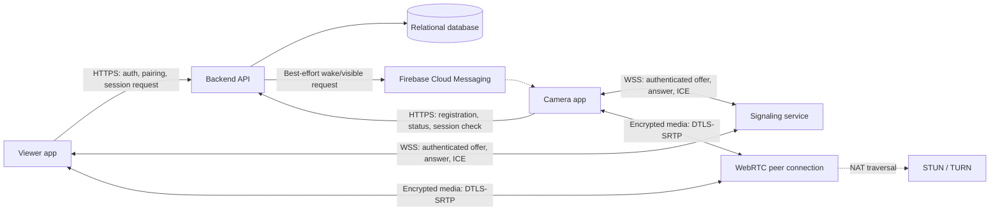
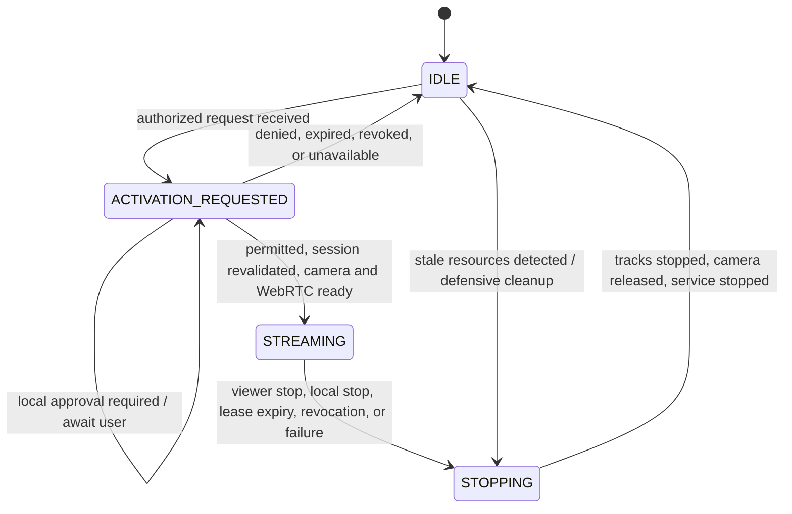

# AskCam: feasibility and architecture (Milestone 1)

**Status:** architecture proposal; no application or backend implementation has started.
**Decision:** ordinary Android applications cannot promise to activate a camera remotely on a locked, screen-off phone. For consumer devices, use a user-visible activation flow. Treat unattended activation on managed or vendor-supported hardware as an optional deployment mode that must pass a version- and device-specific proof of concept.

## Executive feasibility finding

The desired behavior has two distinct cases:

1. **A session was activated while the camera app was visible.** A camera foreground service can keep a camera session alive as the UI backgrounds or the display turns off, subject to Android policy, an ongoing user-visible notification, permissions, and OEM behavior. Verify lock-screen and screen-off operation on each supported device family.
2. **The camera app is idle/backgrounded and the phone is locked when a remote request arrives.** On ordinary consumer installations, there is no reliable, generally available, policy-compliant mechanism to silently grant camera access and start a camera foreground service. Background service-start exemptions and push delivery do not themselves guarantee that camera while-in-use permission is available. The app must report that activation requires local user interaction rather than claim success.

Device-owner/fully managed deployments and certain companion-device arrangements may qualify for platform exemptions, but those exemptions are not a blanket promise of unattended camera access. The exact Android release, target SDK, enrollment, policy, permissions, and OEM build must be tested before advertising this mode. Do not treat device management as permission to hide camera use or bypass privacy indicators.

**Evidence status:** this is a platform-contract assessment, not a device-tested result. The official Android and Firebase reference links below identify the rules to validate. Live retrieval of those pages was unavailable in the authoring environment, and no Android devices or emulator were available for a proof of concept. Accordingly, no device-specific behavior is claimed as experimentally verified.

## Android version and activation constraints

| Platform level | Relevant behavior | Product consequence |
|---|---|---|
| Android 10 (API 29) | Camera and microphone runtime permissions are while-in-use permissions. Background camera use is restricted; a foreground service does not make arbitrary background camera access permissible. | Start the camera while the app is visible. Verify that an already-running, correctly declared camera foreground service remains operational after screen-off on target devices. |
| Android 11 (API 30) | One-time permissions and additional background permission UX apply; users can revoke permissions and processes can be reclaimed. | Handle permission revocation and process death; never assume prior consent guarantees camera availability. |
| Android 12–13 (API 31–33) | Background foreground-service starts are generally restricted, with defined exceptions. Android 13 adds notification permission behavior. | FCM delivery is not a general-purpose background-start entitlement. Keep an activation request pending or reject it when the app cannot legally start. |
| Android 14 (API 34) | Apps targeting API 34 must declare appropriate foreground-service types and permissions. Camera is a while-in-use resource; creating a camera FGS from the background can fail even where a general FGS-start exception applies. | Start the camera FGS from a visible, user-authorized flow. Treat managed-device exemptions as a separate, unproven deployment profile. |
| Android 15 (API 35) and later | Additional restrictions apply to some FGS starts from boot receivers; camera access and while-in-use restrictions remain material. Newer releases can add constraints. | Never automatically resume camera capture after reboot. Re-check current target-SDK and OS rules and run compatibility tests on each supported release. |

Across all versions, the camera indicator and permission model are system-controlled. Screen lock, Doze, vendor battery managers, another app holding the camera, low battery, revoked permissions, process termination, and network loss can each prevent or interrupt a session. An active session must fail closed: stop transmission and release camera resources when its authorization or control connection expires.

## Activation mechanisms compared

| Mechanism | What it can do | What it cannot promise | Recommendation |
|---|---|---|---|
| Visible app / explicit local action | Obtain user interaction and start a camera FGS in a supported state. | No unattended activation while the phone is locked. | **Default and supported consumer flow.** Show a pending request and an unmistakable local accept/deny action. |
| FCM high-priority message | Promptly notify an app of time-sensitive, user-visible work when delivered. | Reliable delivery, continuous connectivity, camera permission, or a right to start camera capture. High-priority use is subject to Google policy and may be deprioritized if it does not produce user-visible notifications. | Best-effort notification/request signal only. Never use as video transport or as a permission bypass. |
| WebSocket or persistent connection | Carry authenticated status and signaling while the process/network connection is alive. | Survival through process death, Doze, network handover, OEM background limits, or force-stop; camera access authorization. | Use only during a live/foreground-supported session, not as an idle keep-alive strategy. |
| Companion Device Manager (CDM) | User-mediated association and selected background/companion-device capabilities for supported companion scenarios. | General internet push, a camera permission, or universal silent camera activation. CDM is not a way around camera privacy restrictions. | Evaluate only if product scope includes an actual companion-device relationship; not the baseline activation mechanism. |
| Device/profile owner or dedicated managed device | Some management configurations may qualify for documented background-execution or permission exceptions. | A universal guarantee across OS/OEM versions, or permission to conceal capture. | Optional enterprise/dedicated-device profile, gated on a compliance and real-device PoC. |
| Reboot receiver / scheduled work / battery-optimization exemption | Perform permitted maintenance or user-visible work. | Restarting camera capture silently after boot or providing real-time, reliable activation. | Never start or resume capture this way. Respect user and system battery controls. |

### Answer to the central question

**Can a remote viewer activate the camera on a locked, screen-off device without local interaction?** Not as a dependable feature for an ordinary Android app installed on a consumer phone. A pre-existing camera foreground service may continue capture after the screen locks if it was lawfully started while the app was eligible, but that is different from starting a new camera session from idle in the background. A managed-device exception may be viable for a narrowly defined configuration, but must be proven on the actual OS/OEM image and cannot bypass visible system camera indicators.

The product should communicate these states separately: **online**, **request delivered**, **local approval required**, **camera available**, and **streaming**. Online status must not imply that remote activation is currently possible.

## Proposed architecture

Start with a modular Android client and one backend deployment. Keep video off push and signaling infrastructure.

The signaling service may initially be a module in the backend deployment. STUN/TURN provides connectivity, not authentication; issue short-lived TURN credentials. Authenticate every signaling message against the viewer, paired camera, session ID, and expiry. Treat the database as authoritative for pairing, revocation, and session state. FCM payloads should contain an opaque request reference, not credentials or media.

### Trust and session flow

1. Authenticate the owner/viewer; pair a camera with a short-lived, user-confirmed code or QR challenge. Store only revocable device credentials using Android Keystore-backed storage where available.
2. Viewer requests a session over HTTPS. Backend checks account/device authorization, revocation, rate limits, and session expiry, then creates a random, short-lived session ID and notifies the camera best-effort.
3. If camera activation is not permitted in its current Android state, report `LOCAL_APPROVAL_REQUIRED` or a specific unavailable reason. Do not mark the camera active from push delivery alone.
4. Once an allowed activation flow is established, the camera app revalidates the session with the backend, starts the camera FGS, and negotiates WebRTC using authenticated signaling. Require a visible ongoing notification and local stop action.
5. Viewer stop, revocation, lease expiry, connectivity timeout, or any authorization failure transitions to STOPPING. Stop tracks/encoders, close peer connections, release CameraX/Camera2 resources, update backend state, and stop the FGS.

Use an expiring server-side session lease plus heartbeats while streaming; timeout values must be configurable and bounded. On network loss, do not keep capture active indefinitely. Choose conservative expiry behavior, then test reconnection and cleanup across process death and network changes.

## State machine

**Invariants**

- IDLE has no camera instance/session, preview, encoder, media track, or media transmission.
- An activation request is not authorization. Revalidate authorization immediately before camera start and throughout the session.
- STREAMING requires a valid, unexpired session and a user-visible camera foreground service.
- Any uncertain authorization, disconnect beyond the lease, or fatal camera/network failure stops media and releases hardware.
- Camera activation never resumes automatically after reboot or process recovery.
- No microphone permission, audio track, or local video recording in this scope.

## Recommended technology stack

| Area | Recommendation | Rationale / boundary |
|---|---|---|
| Android | Kotlin, Jetpack Compose, AndroidX lifecycle, CameraX; Camera2 only if a proven capability requires it | Native APIs, lifecycle-aware UI, and CameraX device compatibility. Keep camera components out of the idle process path. |
| Async/state | Coroutines and Flow; explicit typed state and error reasons | Structured cancellation and testable state transitions. |
| Dependency injection | Start with constructor injection; add a maintained DI library only when module complexity justifies it | Avoid framework overhead in the initial foundation. |
| Preferences | DataStore for lightweight settings; no Room until durable structured local data is required | Minimize idle work and persistence complexity. |
| Push | FCM data/notification messages for best-effort request notification | Push is a wake/notification channel, not guaranteed command execution or media transport. |
| Media | WebRTC with DTLS-SRTP; STUN/TURN for NAT traversal | Purpose-built low-latency, encrypted real-time media. No video over FCM or WebSocket. |
| Backend | Kotlin/Ktor or another single, maintained HTTP/WebSocket service; PostgreSQL; one deployable application initially | Clear API boundary and transactional pairing/session state without premature microservices. Choose implementation after foundation requirements are known. |
| Auth/secrets | OIDC-compatible account auth; scoped, expiring session credentials; Android Keystore-backed credential storage | Revoke access without embedding secrets in the app. Do not store long-lived TURN credentials in clients. |
| Quality | Gradle Kotlin DSL, Android lint, unit tests, instrumented tests, dependency/version verification | Test state machine and Android lifecycle behavior separately; include a real-device compatibility matrix. |

## Security and privacy decisions

- Pairing requires an explicit user-confirmed, expiring challenge; pairing and device access are independently revocable.
- Authorize every session and signaling action server-side. Use unguessable IDs, short expirations, replay-resistant request nonces/sequence context, rate limits, and audit events without sensitive media content.
- Encrypt API/signaling with TLS and WebRTC media with DTLS-SRTP. Pinning, if considered, must have a safe rotation/recovery plan.
- Never include reusable credentials in FCM payloads or logs. Store tokens in platform-protected storage and support rotation/revocation.
- Keep camera privacy indicators enabled; show a persistent, explicit active-camera notification with a local stop control.
- Do not request microphone permission, record video locally, or expose hidden/background camera surfaces.
- Treat authorization loss, expiration, and ambiguous disconnect as stop conditions. Do not optimistically report success.

## Risks and required proofs of concept

| Risk | Required validation / mitigation |
|---|---|
| Background camera FGS and while-in-use restrictions differ by API/target SDK | Build a minimal PoC that attempts activation only through supported flows on API 29, 31/33, 34, 35, and the then-current release. Record exact exception/failure behavior; do not ship unattended claims. |
| Managed-device exception is mistaken for blanket camera permission | Test device-owner enrollment and camera permission behavior on each intended OEM image. Obtain policy review; retain visible notification and system indicator. |
| Screen-off, keyguard, and OEM power management terminate capture or networking | Run long-duration screen-off tests on at least one older low-memory phone and major target OEMs, both Wi-Fi and mobile data. Measure disconnect-to-release time. |
| FCM is delayed, collapsed, or deprioritized | Treat notifications as best effort, expose pending/unavailable states, and never rely on push to satisfy session deadlines. |
| NAT/firewall prevents direct WebRTC connectivity | Test TURN relay fallback, relay cost, bandwidth, and credential expiry on restrictive networks. |
| Camera contention, thermal load, battery drain, or low battery | Test CameraX errors, adaptive quality, thermal/battery behavior, and immediate release. Define an explicit low-battery stop policy. |
| Process death, force-stop, reboot, permission revocation | Recover to IDLE; never resurrect a session from persisted state without a newly authorized, permitted activation flow. |
| Security token leakage or stale signaling authorization | Review threat model and API; test replay, revocation, expiry, account/device mismatch, and rate limiting before production. |
| Current-release behavior changes after this assessment | Re-check official docs and CTS/device behavior before setting min/target SDK or support claims. |

## Incremental implementation plan

1. **Milestone 1 — Feasibility and architecture (this document):** record support boundary, state invariants, trust boundaries, risks, and PoC gates. No full application implementation.
2. **Milestone 2 — Project foundation:** create Android modules and backend skeleton, build/lint/test pipelines, environment configuration, typed domain/state model, and architecture tests. No camera activation yet.
3. **Milestone 3 — Registration and pairing:** authentication, device enrollment, pairing/revocation, server-authoritative online status, and safe credential storage. Add API tests.
4. **Milestone 4 — On-demand activation:** first run the background/locked-device and foreground-to-screen-off PoCs. Implement only proven activation paths, typed blocked reasons, strict lifecycle/state machine, camera cleanup, notification, and timeout tests.
5. **Milestone 5 — Live streaming:** signaling authorization, WebRTC offer/answer/ICE, TURN, viewer controls, adaptive quality, and no-audio/no-recording assertions. Add loopback and real-device tests.
6. **Milestone 6 — Reliability and security:** leases, disconnect handling, revocation, permission/process/reboot tests, threat review, abuse controls, and security testing.
7. **Milestone 7 — Production readiness:** older-device battery/thermal measurements, OEM/Android compatibility matrix, release signing/configuration, backend deployment and operations docs, and explicit supported-device claims.

Proceed to Milestone 2 only after approval of the support boundary and architecture. The key product decision to approve is whether the default consumer experience may require local camera-phone approval, with unattended activation restricted to a separately validated managed-device offering.

## Reference material

These are the primary references for implementation-time verification. Platform behavior must be rechecked against the current Android release and target SDK.

- [Android: Restrictions on starting a foreground service from the background](https://developer.android.com/develop/background-work/services/fgs/restrictions-bg-start)
- [Android: Foreground service types — camera](https://developer.android.com/develop/background-work/services/fgs/service-types#camera)
- [Android: Foreground service changes](https://developer.android.com/develop/background-work/services/fgs/changes)
- [Android 14: Foreground service types are required](https://developer.android.com/about/versions/14/changes/fgs-types-required)
- [Android 15: Behavior changes and foreground services](https://developer.android.com/about/versions/15/behavior-changes-15#fgs-changes)
- [Android: Companion device pairing](https://developer.android.com/develop/connectivity/bluetooth/companion-device-pairing)
- [Firebase: Set and manage message priority](https://firebase.google.com/docs/cloud-messaging/android/message-priority)
- [Android: Camera permissions](https://developer.android.com/training/permissions/requesting#runtime)
